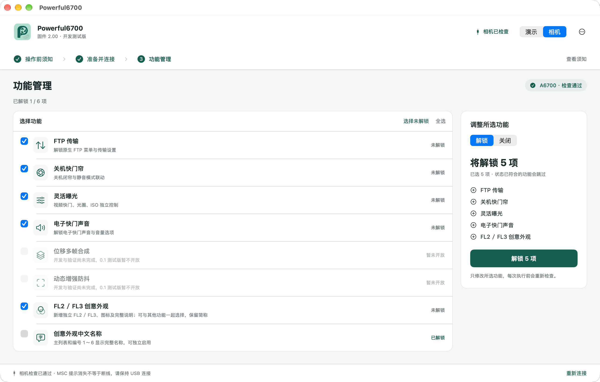

[简体中文](README.md) | **English** | [Español](README.es.md)

> Community translation of [README.md](README.md) as of Powerful6700 0.5.2. If anything here differs from the Chinese original, the original is authoritative. Apart from the [disclaimer](声明与使用边界.en.md), the linked documents are currently available in Chinese only.

A personal learning record on the Sony A6700's firmware and USB maintenance protocol, sharing tutorials that have been worked through end to end and the experimental **Powerful6700** tool. Not affiliated with Sony.

Currently targets only the **A6700 on firmware 2.00**. These operations may affect your warranty and carry a risk of the camera failing to boot and of data loss. Please read the [Disclaimer and Usage Boundaries](声明与使用边界.en.md) first.

## Start here

| What you want to do | Where to go |
|---|---|
| Use the one-click unlock app | [Download the test build](https://github.com/xyzhangxin/sony-a6700-powerful/releases) · [User guide](Powerful6700使用说明.md) |
| Understand how a regular USB connection gets temporary root execution | [USB root tutorial](USB进入root教程.md) |
| Unlock or disable features from source | [USB feature flashing tutorial](USB功能刷写教程.md) |
| Use a Pico to enter Fastboot and read a backup | [Hardware guide](硬件说明.md) · [Operations manual](操作手册.md) |

**Powerful6700 0.5.2** ships as two standalone installers built from the same frozen source: macOS (Apple Silicon, macOS 13+) and Windows x64. Both bundle their own runtime and keep a demo mode. **7 features** are currently available (FTP, shutter curtain closed at power-off, flexible exposure, electronic shutter sound, FL2/FL3, Chinese names for Creative Looks, and **10-slot custom shutter sounds**). The app also includes a **Shutter Sound Market** (7 built-in default/sample shutter sounds, with preview, favorites, multi-format import, `<=350 ms` waveform trimming and 10-slot replacement), the `flags=4..7 rev=6` unified base that guards against permanent lockups, and a "Lossless Restore" entry that keeps your 10 audio slots. Pixel Shift Multi Shooting and Dynamic Active stabilization are temporarily disabled.

Building on 0.5.1, 0.5.2 upgrades the custom shutter sound unified boot base to `rev=6` (a single fault is automatically isolated and recovery is retried on the next normal cold boot; `rev=5` receipts and both versions of `probe.elf` remain compatible). It adds a diagnostic that breaks native status 8 down into specific cases, and a "Lossless Restore (keep audio)" flow that preserves your 10 audio slots and settings. It keeps voluntary anonymous usage statistics (on by default), automatic failure uploads (no contact email included), Ed25519-verified in-app updates on Mac, and health rollback. See the [changelog](应用/CHANGELOG.md) for details.

Windows x64 0.5.2 is built together with the Mac version from the same frozen source package. It brings over the Shutter Sound Market (7 default sounds, overwrite confirmation for the 10 slots, 64-segment waveform trimming, `winsound` preview and Media Foundation multi-format decoding), the Lossless Restore button and status 8 guidance, a right-aligned feature list with a "Go to Shutter Sound Market" button, and the unified menu and diagnostics pipeline. The first connection still installs WinUSB through a one-time driver helper; the main app and firmware operations do not run with elevated privileges. For installation and tested limits, see the [Windows notes](应用/docs/WINDOWS.md) and the [validation record](应用/docs/VALIDATION.md).

## Development plan and progress

- **Feature development:** First, improve compatibility and testing for the existing four features. FL2/FL3 has passed on-camera acceptance testing and is integrated into the app; Dynamic Active stabilization and others are still being researched. Unverified items are not treated as available features.
- **Open source and tooling:** Publish the tutorials, the app and its matching source code, and gradually improve compatibility across individual camera units and the connection experience. Full backup/restore, more platforms and feature-pack updates will follow later.

See [Development plan and progress](开发计划与进展.md) for details. The app source is in [应用/](应用/) and the Pico source is in [源码/](源码/). To help improve the project, see [Contributing](参与开发.md) and [AGENTS.md](AGENTS.md).

### Folder names

| Folder | Meaning |
|---|---|
| `应用/` | App (Powerful6700 source, tests and docs) |
| `源码/` | Source (Pico host protocol, scripts and board code) |
| `已验证文件/` | Verified files (fixed Pico/RAM boot files with sources, hashes and licenses) |
| `图片/` | Images |

## Support the project

If this project helps you, you're welcome to voluntarily chip in a little toward AI token costs to help speed up development and validation.

  

## Reference projects

- [ILCE-7M4-RE](https://github.com/DavidBuchanan314/ILCE-7M4-RE): reference for the BootROM, Pico boot and RAM Fastboot.
- [Arduino-Pico](https://github.com/earlephilhower/arduino-pico): RP2040 build environment.
- [Sony-PMCA-RE](https://github.com/ma1co/Sony-PMCA-RE): reference for the USB maintenance protocol and authentication.

The project's own code and documentation are licensed GPL-3.0-only. For third-party sources and license status, see [NOTICE](NOTICE) and the [app's third-party notices](应用/THIRD_PARTY_NOTICES.md). Please do not upload firmware, private backups, camera body data or credentials.

## Contributors and acknowledgements

- [@zhuorantiancheng](https://github.com/zhuorantiancheng): fixed false positives in the compatibility check caused by ext2 inode timestamp drift, in [PR #7](https://github.com/xyzhangxin/sony-a6700-powerful/pull/7).
- [@wanghm105](https://github.com/wanghm105): reported, from a real camera, the compatibility check failing after a camera restart, which helped pinpoint the issue above.
