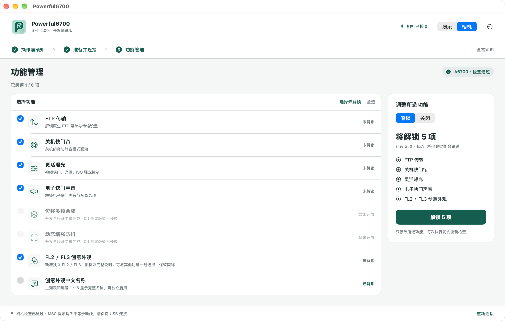

个人对 Sony A6700 固件与 USB 维护协议的学习记录，分享已走通的教程和 **Powerful6700** 实验工具，与 Sony 官方无关。

目前仅针对 **A6700、2.00 固件**。操作可能影响保修，存在无法启动及数据丢失风险；请先阅读[声明与使用边界](声明与使用边界.md)。

## 从这里开始

| 想做什么 | 入口 |
|---|---|
| 使用一键解锁应用 | [下载测试版](https://github.com/xyzhangxin/sony-a6700-powerful/releases) · [使用说明](Powerful6700使用说明.md) |
| 理解普通 USB 如何取得临时 root 执行能力 | [USB 进入 root 教程](USB进入root教程.md) |
| 从源码执行功能解锁／关闭 | [USB 功能刷写教程](USB功能刷写教程.md) |
| 用 Pico 进入 Fastboot 并读取备份 | [硬件说明](硬件说明.md) · [操作手册](操作手册.md) |

**Powerful6700 0.4.1** 继续面向更多用户测试，安装包仅支持 Apple Silicon、macOS 13+，内置运行环境，保留演示模式。开放 FL2／FL3、创意外观中文名称、FTP、关机快门帘、灵活曝光和电子快门声音，可一起勾选、逐项解锁／关闭。位移多帧合成、动态增强防抖暂禁用。

0.4.1修正切换FL2／FL3的一处越界读取，支持旧版显示“已解锁 · 可更新”，直接更新修复包，无需先卸载，保留中文及其他功能。关闭功能时先自动恢复对应机身设置，再撤回所选功能并独立回读。保留中文名称独立开关、FL23完整卸载和[PR #7](https://github.com/xyzhangxin/sony-a6700-powerful/pull/7)的守卫修复；完整备份恢复尚未提供。维护者机身已完成修复及旧包升级验收，第三方反馈机继续复验。更新详情见[变更记录](应用/CHANGELOG.md)。

Windows x64 0.4.1同步上述功能，新增一次性驱动助手处理安装WinUSB、UTF-16 INF兼容、安装超时真实绑定复核及SetupAPI与驱动库独立复核；普通Windows首次驱动安装与连接验收已通过。安装与边界见[Windows说明](应用/docs/WINDOWS.md)。

## 开发计划与进展

- **功能开发**：先完善现有四项功能的兼容性与测试，FL2／FL3已完成机身验收并接入应用，动态增强防抖等仍在研究；未验证项不作为可用能力。
- **开源与工具**：公开教程、应用及对应源码，逐步改善跨机身适配和连接体验；完整备份／恢复、更多平台及功能包更新后续推进。

详见[开发计划与进展](开发计划与进展.md)。应用源码在[应用/](应用/)，Pico 源码在[源码/](源码/)；参与改进见[参与开发](参与开发.md)和 [AGENTS.md](AGENTS.md)。

## 支持项目

如果这个项目对你有帮助，欢迎自愿支持一点 AI Token 费用，帮助加快开发与验证。

  

## 参考项目

- [ILCE-7M4-RE](https://github.com/DavidBuchanan314/ILCE-7M4-RE)：BootROM、Pico 引导与 RAM Fastboot 参考。
- [Arduino-Pico](https://github.com/earlephilhower/arduino-pico)：RP2040 编译环境。
- [Sony-PMCA-RE](https://github.com/ma1co/Sony-PMCA-RE)：USB 维护协议与认证参考。

自有代码与文档采用 GPL-3.0-only；第三方来源及许可状态见 [NOTICE](NOTICE) 与[应用第三方归属](应用/THIRD_PARTY_NOTICES.md)。请勿上传固件、私人备份、机身数据或凭据。

## 贡献者与致谢

- [@zhuorantiancheng](https://github.com/zhuorantiancheng)：通过 [PR #7](https://github.com/xyzhangxin/sony-a6700-powerful/pull/7) 修复 ext2 inode 时间戳漂移导致的兼容性检查误报。
- [@wanghm105](https://github.com/wanghm105)：提供相机重启后兼容性检查失败的实机问题报告，帮助定位上述问题。
