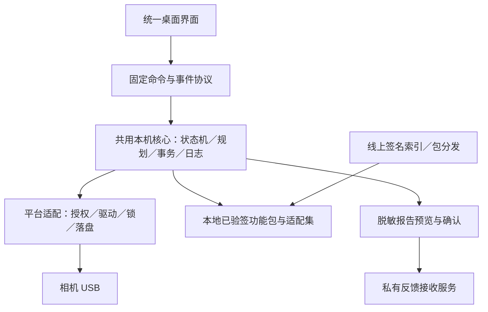

# Powerful6700 跨平台、在线更新与功能包方案

2026-11-07，用户已确认的项目结构设计基线（架构约定第1版）；插件、流程引擎和统一界面尚未实现；云端服务已有独立实现并于2026-11-07按本次明确授权部署，客户端接入仍待完成。目标：降低功能改动带来的整包升级次数，让 Mac／Windows 共用产品流程、功能定义、事务与反馈。维持用户先审核再更新 GitHub；本方案不授予相机写入或线上部署权限。

## 0. 后续开发必须遵守

本文件是应用结构设计的唯一总规范；引用的服务端专项文档细化对应边界，不另立应用架构。根AGENTS、应用AGENTS、代码地图及架构文档只维护入口和约束摘要，不另建平行方案。公开仓库中的同名文件是发布镜像：从本文件同步，允许调整本地证据链接；不独立演化第二套架构。新增代码的目录落点与已有主题／入口一致，不为遵守目标架构立刻复制、批量移动或重建已绑定路径。

- **唯一共用核心**：状态机、功能规划、事务、验收、日志及版本管理由同一核心实现；Mac／Windows仅保留权限、驱动、锁、持久化、路径与打包差异。两端界面不得复制USB或补丁实现。
- **能力包三件套**：修改定义＋开启／更新／关闭流程定义＋验收定义成组版本化；对应profile、掩码、载荷、源码与依赖成组校验。不允许仅更新JSON放宽旧写入器地址。
- **核心控制阶段**：准备、身份与守卫、持锁执行、独立回读、退出和结果记录不可由插件删除或绕过。步骤声明化，不加载任意宿主脚本；未知能力必须明确拒绝。
- **证据分别记录**：设置准备、写入回读、服务退出、重启就绪和逐项功能验收分开；人工确认、设备观察、计时经过不能混称通过。FL23约40秒为开机后的预计加载提示，不是自动成功条件。
- **先合成再执行**：多功能只合并阶段、目标、起点及证据语义一致的步骤；同扇区、共享CP／启动入口、设置目标和依赖冲突先核对；验收仍按功能独立保存。
- **操作版本固定**：用户确认后固定核心、适配集、包、流程及文案快照，事务中不联网取依赖、不热替换、不自动重发；恢复的是检查向导，设备访问仍须新鲜预检。
- **线上服务有边界**：服务只负责分发、文档、可由用户关闭的最小化实例统计和用户确认的脱敏反馈，不实时生成写入指令或接管相机；已验证包保留离线能力。原始事务／恢复资料不作为普通日志上传或缓存清理。
- **渐进迁移**：先归一核心和契约，再能力包／更新／日志，最后验证并迁移统一界面。Tauri是待验证候选，不是已实施或必须立即更换的框架；示例字段在形成版本化schema前不得当作既有API。

变更说明须列明：涉及的层与模块、包／核心／协议版本影响、准备与验收变化、平台覆盖、对应检查及未验证边界。若要改变本规范的职责边界或契约，先更新本文件与理由／迁移说明，再按既有审核流程推进；不通过新增私有分支逻辑、复制脚本或放宽守卫绕过设计。源码迁移后修正本文件的代码地图；设计确认不等于运行功能已交付，更不授予相机写入、云端部署或GitHub发布权限。

2026-11-16，0.4.3 最新修订版默认开启使用统计和后台故障报告。「统计与诊断」提供两个独立开关，保留已有关闭设置。后台报告只发送本次失败的白名单诊断，不扫描历史记录，不附邮箱。手动上传可选填邮箱，复用相同的脱敏计划与执行结果附件。演示与离线自检不触发上报。

### 0.4.3.dev1 的渐进变更（2026-11-14）

共用核心新增失败报告白名单适配与自愿统计队列，平台 UI 只预览并提交固定命令。桌面协议仍为 API 1（向后兼容增加 `prepare_and_inspect`、统计开关、失败报告预览／上传），合并准备在状态锁内复用原确认与连接守卫；原事务、能力包、载荷与写后验收不变。Mac 优先验收，Windows 后续同步；自定义快门声研究从本轮桌面适配集及 Mac 资源中排除，不改变研究工具的显式候选。云端 0.2.0 新增可选事件契约和 `0004` 迁移，本地验证不等于已部署。

## 1. 已确认的结构决策

采用「统一桌面界面＋共用本机核心＋平台适配器＋签名功能包＋轻量在线服务」。相机认证、写入与验收判定全部在本机。离线保留已验证包及基本功能；云端不可用不阻断已有包的使用。用户无需账号即可使用，反馈由其主动确认。

先做核心归一和功能包协议，再迁移统一界面。不要把换界面框架、重写 USB、开发插件商店和整机恢复捆成一次重构。

## 2. 当前代码核对：哪些确实相同

只读对照本机 `release/` 的 Mac 0.4.1 源码与 `opensource/sony-a6700-powerful/应用/` 的 Windows 0.4.1.dev2 源码；不是 GitHub 远端同步性或 Windows 实机验收证明。

共存的 34 个 Python 模块中，24 个文件字节一致，10 个不同；Windows 另有 `host_io.py`、`windows_driver.py`。版本文件也计入这10项，不能把文件数当成可复用代码行比例。两侧 `data/a6700-2.00.json`、`data/device-profile.json`、原四项 reader／writer ELF 及 `data/fl23/manifest.json` 字节一致；没有据此宣称所有资源均一致。

| 领域／当前入口 | Mac 当前实现 | Windows 当前实现 | 目标归属 |
|---|---|---|---|
| 界面 | `desktop/macos/` SwiftUI | `desktop/windows/` PySide6，已对齐Mac样式 | 一套界面与交互测试；平台对话框少量适配 |
| 准备、选择、状态机、菜单检查 | `desktop/controller.py`、`preparation.py`、`desktop/aftercare.py` | 同源模块，当前字节一致 | 共用核心；界面只展示状态与发送固定命令 |
| 功能规划与修订识别 | `catalog.py`、`device_profile.py`、`feature_updates.py`、`creative_looks.py` | 共用；`planner.py`含平台文件打开标志适配 | 共用规划器＋机型适配数据 |
| 事务、关闭前设置、FL23安装 | `operations.py`、`close_*`、`fl23_package.py` | 主要同源，记录落盘方式有差异 | 共用事务；把落盘及互斥抽成平台接口 |
| USB 双次认证与帧协议 | PyUSB／libusb，MSC→服务身份 | 同协议，DLL及驱动准备不同 | 共用协议与传输层；平台只准备访问条件 |
| Mac USB 接管 | 原生 `mac_capture.m`，系统管理员授权，释放MSC占用 | 不适用 | Mac专用、固定目标的最小权限助手 |
| Windows 驱动准备 | 不适用 | `windows_driver.py`，SetupAPI检查，专用UAC助手与固定libwdi | Windows专用；主应用和功能事务普通权限 |
| 文件与目录持久化 | 文件刷新＋POSIX目录fsync | CREATE_NEW／write-through／逐文件刷新 | `host_io`平台接口；不能以NTFS日志代替断电持久性证明 |
| 设备锁与状态目录 | `flock`、Application Support | `msvcrt`、LOCALAPPDATA | 一套锁语义、两个实现；保留既有共享锁路径 |
| 占用诊断 | 可核实同用户进程身份后确认接管 | 手动在原工具结束任务 | 共用状态呈现；平台能力明确返回，不强求相同按钮 |
| 依赖与打包 | 内置Python、dylib、原生助手、开发签名 | GUI＋worker、DLL、驱动助手与依赖源码 | 共用构建契约，分平台产物与验收 |

10个差异模块：`__init__.py`、`backup.py`、`bundled.py`、`connection_takeover.py`、`doctor.py`、`fl23_package.py`、`operations.py`、`planner.py`、`usb/backend.py`、`usb/legacy.py`。平台行为不能仅通过整文件覆盖来归一。

## 3. 目标分层



- UI只提交功能ID与操作意图，不提供偏移、命令行、磁盘路径或设备后端注入接口。
- 固定协议至少定义 `request_id`、`operation_id`、`api_version`、`capabilities`、阶段ID、状态、进度及可执行下一步。重连与迟到消息不能重放写入。
- 平台接口分为 `prepare_access`、`acquire_device_lock`、`open_transport`、`write_record_exclusive`、`flush_record`、`release_access`；返回明确阶段和能力，不把所有失败统称“连接失败”。接口为设计命名，不是当前已存在API。
- UI与引擎使用本机受限IPC；应用启动引擎，退出时正常结束。首版不安装常驻网络服务，不开放无配对的localhost写入接口。
- 仍须遵循既有共享调试台排队、前序结果核对、写前重规划、持锁新鲜读取和独立回读。进程退出后也必须发现未闭合事务并停止自动续写。

### 3.1 脚本使用的有界 USB 会话（2026-11-12）

脚本会话复用上述唯一核心，入口为 `session.py`／`msc_tool.py`，研究工程 `scripts/msc-tool` 只负责定位同一源码与调试台。整个 worker 生命周期对应一个持续运行的 bench job，任务内自己持有原共享锁；会话中 CLI／SDK 仅通过受配对信息保护的本机 IPC 访问该 worker，不再提交嵌套任务或自行认证。桌面既有事务结束后退出的行为不变。

`a6700.msc-session/v1` 只开放固定方法：status、result、stop、read、inspect、plan、apply。read 的范围必须落在既有 profile，底层仍运行完整固定读取器；写入仅选择已开放的普通功能及 unlock／close，不能传载荷、profile、before／after、任意掩码或未登记地址。创意外观／自定义声音等独立执行器尚未接入该脚本协议；使用原能力解析器的固定执行器子集，不加载未开放研究能力包的资产，默认桌面适配集不变。plan 固定本会话、一次性计划 nonce、profile／前态／执行资源／能力解析摘要及关闭前设置快照；apply 明确确认后先重新读取并核对前态，关闭前设置快照变化则在任何设置修改前拒绝，再走原有准备、结构守卫、原生事务、独立回读与日志，不复制业务逻辑。

空闲期限、总期限与信号仅在请求边界触发排空，不能中断写入／回滚。结果未知不重发；原生执行是否已返回、事务回读是否通过、STOP 是否确认及真实 MSC 是否观察到分别记录。未确认执行返回时仅释放宿主句柄，不发送 STOP。每个请求先独占持久化意图再执行，记录未闭合写入会阻断后续会话写入；原生执行尚未确认结束的前序记录会在新会话认证前拒绝，不能以重新连接探测绕过。端点恢复仅在调试台任务内、共享锁空闲且登记进程不存活时清理失效 IPC 端点，保留全部事务与恢复资料，不操作相机。

POSIX IPC 使用私有 Unix socket，Windows 适配使用随机 loopback 端口及同一随机配对令牌；无开放 HTTP 写入接口、不安装系统常驻服务。当前版本的离线／实机证据及平台边界以 [MSC 会话说明](MSC-SESSION.md) 为准，不能据接口存在宣称 Windows 实机或动态通用载荷已完成。协议、平台适配和生命周期为本次新增范围，能力包和原生事务格式不变。

2026-11-13 部署：本机共享调试台新增固定生命周期入口，管理同一个 worker 的排队、复用和排空。HTTP 层只管理生命周期，写入始终走原配对 IPC 和唯一核心。原供电入口在同一设备锁内共用会话日志的未闭合事务判断。详见[调试台说明](../../a6700-testbench/validator/README.md#托管能力与脚本入口2026-11-13)。

统一UI优先验证Tauri＋Web界面，内置已验证Python引擎作为sidecar；Rust壳只处理窗口、受限IPC和系统集成。界面资源随包分发、离线可用，网站用于介绍、下载和文档。Tauri的sidecar与updater可复用，但引入新构建链，须先验证Mac接管、Windows驱动、关窗／崩溃行为及两端样式。若预研代价超出收益，先保留两套壳；核心归一和功能包协议不依赖换壳成功。

## 4. 插件是什么，以及开放到哪一层

首版插件是经过审核发布的「版本化能力包」，不允许从网络加载任意宿主Python／JavaScript／DLL。用户仍看普通功能列表，无需理解插件目录。

| 包类型 | 包含什么 | 首版开放程度 |
|---|---|---|
| 展示与流程定义 | 中文名称、说明、准备路径、检查标准、固定操作阶段 | 允许声明式更新，UI只渲染固定组件 |
| 音频资源包 | `a6700.audio-package/v1`元数据、PCM WAV文件清单、SHA-256、时长／采样率／声道／位深、标签与许可证 | 纯数据包，允许市场浏览／试听／共享；不得携带代码、地址或执行器 |
| 功能定义 | 稳定功能ID、修订、依赖／冲突、已知状态、开启／关闭流程 | 可独立版本；必须由核心支持的操作组合表达 |
| 机型适配集 | 机型／固件、结构守卫、profile、掩码、reader／writer及各功能包精确版本 | 成组发布、验签、原子激活；拒绝终端任意拼接偏移 |
| 相机运行载荷 | 自编ELF、FL23 carrier、recipe、绑定源码与构建来源 | 可随适配集更新；维护者审查、签名和明确权限范围 |
| 宿主驱动／提权助手／新执行器 | WinUSB准备、Mac接管、核心新增原语 | 随应用升级，不作为普通插件自动替换 |

签名证明发布来源与字节完整性，不证明代码正确，也不能把相机内root载荷变成安全沙箱。原生载荷必须保留源码、构建方法、范围审查和真实验证；普通数据插件无权偷偷升级为原生载荷插件。首次可信发布者限定项目维护者，第三方通过PR贡献和审核进入发布通道；不默认信任第三方仓库或任意导入ZIP。

音频资源包与能力包分开版本化：能力包描述相机修改与流程，音频资源包只描述可导入媒体。市场索引可以同时列出二者，但解析、信任和执行边界不同；音频包选择永远不能自动生成相机写入计划，必须经用户在本地确认导入。

### 绑定规则：解决当前真正的限制

现有设备profile、原生写入器掩码、源码摘要是强绑定的。新增字段／地址需要新的成组载荷及验收，不能仅修改JSON让旧写入器接受。拟增加的注册表按以下关系解析：

`功能版本 → 已审核适配集 → 精确profile＋载荷＋前置设置观察器＋恢复覆盖信息`。

功能对用户独立显示，发布端负责组合解析、同扇区所有权和依赖检查；客户端执行已发布的精确组合。共享FL23与中文名称的启动入口／外部包必须声明依赖、保留策略和组合变体，不按“每功能一份文件”简单拆开。备份绑定旧profile时继续走原格式校验，不自动改哈希或猜新偏移。固定恢复基线继续复用，功能包变更不自动生成新的整机恢复版本。

2026-11-14，用户指定自定义快门声复用同一个 `startup-loader`，以独立动作 `custom_shutter_sound` 启动，最早在开机 10 秒时尝试。快门声能力只依赖基础电子快门声音，可与 FL23、中文名称分别启用。任一功能仍使用共享入口时保留启动器。快门声的服务和回调由其驻留宿主管理，寿命覆盖动作返回后。当前能力定义已声明共享资源与动作，机身组合和实际调度仍待验证。

### 包契约（字段建议，非已实现格式）

每个包登记：`schema_version`、`package_id`、`version`、`release_sequence`、`min_core_api`、`required_capabilities`、目标机型／固件／profile摘要、依赖与冲突、替代或迁移来源、文件清单（长度与SHA-256）、源码来源及许可证、验收范围、签名key_id。宿主工具另标OS／CPU，机内ARM64载荷不因电脑是Windows x64就改编译目标。

顶层发布索引同时签名，列出稳定／测试通道、精确适配集、摘要、撤回标记和过期时间；签名覆盖精确元数据字节与文件摘要，信任公钥由应用固定。拒绝过期／旧序列重放、未知签名者、不兼容schema、危险归档路径／符号链接、超额解压和冲突权限。初期只保留少量公开测试能力，不能用“插件化”放行未验证功能。

## 4.1 操作流程契约：让修改、准备与验收一起版本化

共享调试台复用同一套本机操作契约。调试台管理队列、设备锁交接、USB 会话及任务记录；能力包提供修改、流程和验收定义；共用核心验证包与适配集并生成本次写入计划。兼容现有执行步骤的新增包复用同一入口。需要新执行步骤时，由共用核心实现该步骤并扩展契约。独立安装器仍可走调试台原有任务队列；在托管会话内按包规划并复用认证是后续接入项。[调试台入口](../../a6700-testbench/validator/README.md#托管能力与脚本入口2026-11-13)

2026-11-16 应用十槽接入沿用同一核心：API 1 增加固定 `refresh_audio_slots` 命令，界面只渲染完整快照；读写复用服务文件保存／恢复。共用 `create_installation_journal` 记录音频前态与意图，沿用未闭合能力包事务阻断规则；未知执行不自动重发或停止。此切片未开放正式导入能力，恢复核心新增前态摘要校验、固定槽新鲜绑定和共享恢复事务，未知执行不重发；调用方仍负责身份核对及服务退出。音频事务 v2 复用 PackageBinding 固定机身／加载器／profile，恢复要求相同绑定；PhysicalService 在写前要求新鲜绑定并再次比较。正式 USB 后端已补认证前 fresh MSC 身份读取，应用核对其与加载器绑定一致；正式后端已接固定观察器进行新鲜加载器读取及匹配，观察器自编载荷／源码／清单成组提供、可独立重建。桌面恢复入口及端到端硬件验收继续补齐。

2026-11-14 确认自定义快门声的实机写入及独立回读由共享调试台统一执行。快门声专题维护 A6700 2.00 的写入产物、目标、前态及功能验收。

2026-11-13 确认共用安装事务和机身适配的分工。安装器固定能力包版本、适配和机身身份，在共享锁内核对新鲜前态、保存可恢复数据、执行计划、独立回读并记录结果。写入或最终回读失败时，根据新读回确定恢复顺序，恢复后再核对完整前态。机身适配提供当前机型和固件支持的读写与恢复操作，以及开机加载、设置、实际播放和 GUI 回调。撤回计划按当前依赖明确列出目标，共用资源仍有使用方时列为守卫。适配器由本机核心选定，包文件不提供可执行脚本。

共用核心位于 [`package_installation.py`](../src/a6700_unlock/package_installation.py)。计划与执行层已在模拟适配器上验证。执行层持有共享设备锁，先持久化前态和意图，再逐项记录、执行并独立回读。失败时重新读取整包，按可确认的顺序逆向恢复，再回读完整前态。写入仍可能运行、出现未知状态或恢复无法验证时，保留未闭合事务。共用设备锁入口和调试台的三秒重启路径均检查该记录。实机接入需要由内置适配器提供真实读写、每项写前守卫和执行终止确认，并核对调试台的设备交接。

2026-11-07 确认的完整操作流程仍在逐步接入。对照当前`preparation.py`、`close_preparation.py`、`desktop/aftercare.py`与`desktop/controller.py`：已有公共准备、关闭前状态规则和菜单验收元数据，但FL23等待及结果构建仍有按功能ID分支。目标是让每个能力包交付三份互相绑定的定义：

1. **修改定义**：适配集、执行器能力、已知前态、目标、更新迁移及撤回范围。
2. **流程定义**：针对开启／更新／关闭分别声明前置条件、机身准备、执行后退出、重启及等待步骤。
3. **验收定义**：菜单路径、动作、预期、证据来源、必须／可选、失败后下一步。文案必须与实际运行包同版本，不能独立热替换安全提示。

### 固定阶段，插件填充步骤

核心维护固定骨架：

`本机检查 → 人工通用准备 → 连接与新鲜识别 → 功能特有准备 → 计划与确认 → 执行及独立回读 → 退出服务／释放锁 → 重启与就绪 → 逐项功能验收`。

插件不能删除通用准备、设备身份／守卫、持锁、回读或结果记录。步骤使用有限类型，不运行表达式或云端脚本：

| 步骤类型 | 内容与执行者 | 完成依据 |
|---|---|---|
| `instruction` | 展示必要说明、菜单路径或图片 | 仅记录已展示，不作为设备状态证据 |
| `manual_action` | 用户完成相机模式、断电、菜单／拍摄检查 | 用户确认，明确标记人工来源 |
| `observe` | 调用核心支持的固定只读观察器 | 本次新鲜、目标绑定的枚举结果 |
| `prepare_setting` | 在用户确认的操作范围内调用已验证的固定设置接口 | 运行态／保存态及资源释放重新观察；未知则停 |
| `execute`／`verify` | 既有事务与独立读取器 | 核心判断，插件不得用文案或打勾覆盖 |
| `restart_barrier` | 合并后的安全退出与断电重启引导 | 服务退出结果＋人工步骤；未观察到则不声称自动确认 |
| `wait_for_ready` | 从明确事件开始等待，必要时有限频率观察 | 自动观察证据或人工验收；计时不等于就绪 |
| `acceptance` | 菜单、成像、拍摄保存／回放等检查 | 独立保存每项结果与证据来源 |

自动设置改变机身状态，必须体现在操作预览和日志中；不能因按钮写“关闭功能”就隐去实际设置恢复。无已验证观察器／设置能力时，写入安全前提继续阻断；只有明确设计为人工检查的项目才允许人工确认，不用其替代硬守卫。

条件采用有类型的字段匹配：操作种类、已识别版本／状态、本次改变范围、能力枚举和本次观察结果。区分`true/false/unknown`，unknown不等于false；流程定义需声明unknown时停止或转人工检查的合法分支。禁止动态eval、任意路径、USB请求或Python回调。运行时只渲染已解析的步骤，不在Mac／Win各写一份“如果是FL23”。

### FL23的40秒如何落到流程里

- **时间起点**：用户实际开机后点“已开机”，或未来由已验证的启动观察器产生事件；不是点击解锁、完成下载或插入电池时开始计时。
- **步骤位置**：通常位于写后断电重启后的就绪阶段；如果是在新会话中检查刚冷启动的既有FL23，则按新鲜状态另生成就绪步骤。不能对所有操作都机械地先等40秒。
- **含义**：约40秒是加载时间提示，不是“40秒一到，自动成功”。现有材料没有在应用中证明通用可靠的自动就绪观察器，首版按菜单／预览人工检查，计时结束仅进入“可以开始检查”。
- **开启／更新**：断电至少10秒后开机，显示FL23加载提示，随后检查独立主项、图标、预览、说明、拍摄保存和回放。
- **关闭且不保留相关能力**：按卸载计划退出、断电重启，再检查新增项消失及原有外观正常；不追加等待已卸载FL23加载的步骤。若保留中文等共用能力，其自己的加载条件按组合计划处理，不能因关闭FL23而抹掉。
- **已有即目标状态**：不重复写；是否需要重启／等待取决于实际发生的设置调整、安装状态和新鲜启动证据，不由“选择过FL23”单独决定。

流程片段示意（字段为待定契约，不是已接入的配置；`fl23_work_changed`由核心基于实际计划产生）：

```yaml
feature_id: fl23
workflow_revision: 1
post_restart:
  - id: fl23_ready
    type: wait_for_ready
    when:
      action_in: [unlock, update]
      fl23_work_changed: true
    anchor: camera_power_on_confirmed
    timing:
      kind: estimate
      seconds: 40
      completion: prompt_checks_only
    evidence: user_attestation
    next: fl23_menu_checks
acceptance:
  - id: fl23_menu_checks
    type: acceptance
    method: manual
    path: [曝光/颜色, 色调, 创意外观]
    expected: 主列表有FL2与FL3，图标、预览和说明正常
    required: true
  - id: fl23_capture_playback
    type: acceptance
    method: manual
    expected: 使用FL2与FL3拍摄、保存及回放正常
    required: true
```

倒计时可作为参考，不阻止用户在观察到就绪后进入人工检查；真正的最短断电步骤使用`timing.kind=minimum`，与40秒`estimate`严格区分。超出预计仍未就绪可继续等、查看处理建议或反馈，不自动刷回／重刷。已有版本的拍摄验收定义必须可扩展，不因只检查菜单出现就把成像也记成成功。

### 多功能组合：先合成计划，再给用户一条流程

核心将各包流程编译为一个**串行操作计划**，首版不开发通用可执行DAG引擎。每步带功能归属、稳定ID、相位、前置证据、失效条件、合并键、失败策略和恢复策略。

- 通用准备（供电、USB、MSC、仅一台相机）只出现一次。相机连接及兼容性检查共用，但每个功能自己的守卫仍完整执行。
- 同一机身设置、相同阶段、相同目标和观察语义才能合并；目标冲突直接阻断，不采用“后一个覆盖前一个”。没有显式合并声明的步骤保留顺序与独立验收。
- 写入仍调用已有经验证的执行器并分别回读；同扇区和共享CP／启动入口依赖先检查。不是把多个包的字节列表直接相加。
- 只有执行器允许且所有前提满足，写后重启才合并成一次。某功能要求先重启再写其他内容时，形成中途屏障，重连后重新核对身份、设置和前态，不把屏障挪到最后。
- 断电10秒与开机加载约40秒不能相互合并。等待步骤只有相同起点、目的、证据和最短约束语义时才可合并取约束上界；不同功能的独立就绪条件仍分别满足。
- 重启后按功能分卡验收。合并的是操作动作，不是验收结论；例如FTP菜单存在与真实上传成功是两个不同项目。

例：同时开启FTP＋电子快门声音＋FL23，用户只执行一次通用准备；应用持锁顺序执行各安装器及回读，退出后只引导一次允许合并的断电重启；40秒提示归FL23，之后分别显示FTP菜单、声音试听和FL23拍摄／回放。部分失败按已确认完成范围生成适用的收尾引导，不能套用“全部成功”，也不能在事务不确定时继续后续写入。

### 结果与证据，不能只保留一个success布尔值

目标结果按功能和操作阶段分别保存：

| 维度 | 示例状态 | 含义 |
|---|---|---|
| 设置准备 | unchanged／verified／restart_required／unknown | 本次是否改变机身设置，是否独立确认 |
| 事务 | not_started／no_op／verified／partial／uncertain／rolled_back | 固件执行和独立回读结果 |
| 服务退出 | confirmed／unconfirmed | 与写入结果分开，不相互覆盖 |
| 重启／就绪 | awaiting_user／waiting／observed／user_confirmed／unknown | 不把计时或按钮当自动探测证据 |
| 功能验收 | pending／passed_user／passed_observer／failed／not_run | 哪些项目通过，谁确认的 |

每个验收项目记录`step_id`、适用版本、所需证据、实际证据来源及结果；未适用与用户跳过不同，跳过不能等于通过。展示“写入已核验 · 待重启验收”“菜单已确认 · 拍摄尚未检查”“用户确认通过”等准确结论。自动读取某字段通过，不能代替用户听到快门声或确认照片保存。

本机事务结束、服务正常退出及锁释放后，等待用户重启／检查是一个可保存的向导阶段，不维持假busy，不为人工验收长期占用USB。用户可退出稍后继续；再次设备访问必须重新排队、持锁并新鲜识别，旧预检不再授权写入。

### 云更新、恢复向导与日志

- 用户确认操作前固定`operation_id＋核心版本＋适配集摘要＋流程定义摘要＋参数选择`，把实际步骤和文案快照写入本机记录。在线包更新排到本次结束后激活，不能把已确认流程换成新版。
- 尚未开始的操作可重规划，但改变范围／设置动作后须重新展示确认；已经执行的准备或写入不因重规划被抹去。退出后恢复的是检查向导，不自动重放设置或写入。
- 重开应用读取已固定快照；核心不再支持其步骤时显示只读历史和明确的迁移／处理入口，不静默套用新流程。手工计时在重启应用或系统时间变化后不可可靠延续时，显示时长未知，允许重新计时或人工检查；不能推断已开机并自动通过。
- 日志以`operation_id / feature_id / workflow_revision / step_id / attempt_id`串联，记录进入、观察、确认、执行、回读、跳过、失效、失败、退出；用户确认、计时经过、设备观察三种来源分开。公开反馈包继续采用白名单，不附原始固件或机身身份。
- 插件发布门槛增加流程一致性检查：全部写入都有匹配回读；前置观察在设置修改／重启后会失效；未知步骤／观察器被拒绝；无循环／悬空分支；每个开启／更新／关闭路径有结果与收尾；必选验收不可默认通过。模拟覆盖FL23三种动作、共享中文依赖、无修改、组合成功、部分失败、设置需重启、40秒后未就绪、断线／重开向导和中途包更新。

首个实现切片只覆盖现有六项能力，先把`aftercare.py`的菜单与FL23等待、`close_preparation.py`的规则映射到声明式定义，保持原执行器不变。先跑模拟计划和两端相同的提示快照，再安排实机验证；不直接把现有原生设置操作改成可由任意插件调用的通用setter。

## 5. 用户更新流程与故障处理

| 更新内容 | 是否换安装包 | 是否自动修改相机 |
|---|---|---|
| 说明、菜单检查路径、声明式功能定义 | 核心兼容时不用 | 否 |
| 已支持流程下的新功能／载荷／修复 | 经适配集审核后不用 | 否，仍需用户选择并执行 |
| 新USB协议、平台权限、驱动助手、核心API或界面代码 | 需要应用升级 | 否 |

启动时后台查更新，不强制登录；可关闭检查、忽略当前版本或手动检查。稳定通道默认，测试通道由用户明确选择。网络异常显示离线，已验签并激活的缓存包可继续使用。索引过期时不依据它激活新包；不要求每次执行取得云端授权。已知撤回的包停止新写入，不自动降级，保留诊断与已验证恢复所需资料。离线期间不能得知新的撤回信息，界面显示最近检查时间；刷新索引不打断已开始的事务。

下载→暂存→验签／摘要／兼容及依赖检查→同卷原子激活。执行前将完整依赖闭包、源包摘要和核心版本固定到本次计划；相机锁内再次读前检查，事务期间不下载依赖、不更换包、不自动更新应用。下载失败继续保留当前合格包；执行失联不自动重发。

「切回旧功能包」只改变本机可用文件，不等于把相机恢复旧状态。相机迁移／撤回必须有明确路径、确认和新鲜前态；未知状态保留原记录并停止。保留安装时包及写后记录，直到相关事务闭合，不能因缓存清理删除恢复所需资料。

应用更新可用独立项目更新签名；它与Apple开发者签名／公证、Windows代码签名是不同层次，不保证消除Gatekeeper／SmartScreen提示。现有无需付费Apple开发者计划的约束保留。

2026-11-16 客户端版本检查切片（`0.4.4.dev1` 本地）：Mac／Windows 复用同一后台客户端查询 GitHub 最新稳定 Release。默认相机模式启动检查一次，用户可关闭启动检查、手动检查或稍后处理。应用内按平台选 ZIP，核对下载长度与 GitHub 公布的 SHA-256 后保存，提供本地查看入口。相机功能包继续从既有签名索引检查。宿主安装切换、重启和回退待单独完成并验收。 同日的后续 Mac 候选已接入宿主安装助手，本地通过退出、启动确认和回退。下载及平台筛选仍共用，只有 Mac 原生助手执行应用替换，Windows 开发待后续。项目签名发布流程见 [更新签名与发布运维](UPDATE-RELEASE.md#mac-应用内安装候选2026-11-16)。

## 6. 在线服务边界

安装数口径、API、数据模型、幂等、保留与部署细化见[轻量服务端设计](轻量服务端设计.md)；这是本规范的服务端专项；对应`services/cloud/`已有独立实现及接入文档，已部署并完成合成验收，正式签名索引与客户端接入待完成。安装统计采用独立可选同意，不作为更新或反馈的前提。

| 服务 | 建议首版 | 不承担的职责 |
|---|---|---|
| 安装包及公开源码分发 | GitHub Releases，按平台匹配附件；附更新元数据与签名 | 不决定当前相机能否写入 |
| 功能索引与适配集 | 签名静态文件，先GitHub，可增加受控镜像；同一摘要，不维护两套版本事实 | 不接收相机原始固件，不动态生成写入命令 |
| 自愿实例统计 | 最小化上报＋去重聚合，例如Worker／D1 | 不用硬件指纹，不将下载次数当安装人数 |
| 日志反馈 | 轻量HTTPS服务＋私有存储；例如Worker／R2 | 不远程接管用户相机，不持有用户USB认证会话 |
| 使用说明与已知问题 | 在线文档；核心步骤随包保留 | 文档变更不能跳过本机守卫 |

日志服务与更新服务可以共域名不同路由，但权限和存储分开。首版无需账号体系、远程任务服务、复杂数据库或插件商店。服务域名、部署账户／区域、预算与保留策略实施前单独确定；本提案不新建任何云资源。

## 7. 共用日志与快捷反馈

- 共用结构化事件：`schema_version`、随机operation_id、应用／核心／平台适配器版本、功能包／适配集摘要、系统类型与CPU、功能ID、阶段ID、耗时、稳定错误码、结果、独立回读及退出状态。前端、worker、权限助手共享关联ID，各自注明来源。
- 本机原始事务记录继续保存；上传报告另行白名单构建，默认只包括用户选择的这次操作，UI中断也可选择最近会话。未知字段不自动转发。
- 不上传固件、扇区前态、备份、ProductInfo、校准、序列号、认证信息、FTP地址／账户或原始路径。异常转换为分类码和受控栈摘要；不把整段stdout／traceback直接装ZIP。用户描述可能含私人内容，上传前同样可检查和删除。
- 用户流程：反馈问题→填写现象→预览内容／大小／接收位置与保留期→确认上传→返回反馈编号；失败可导出相同脱敏包。默认不自动上传，不自动重试不确定POST，按反馈ID幂等。
- 服务限制schema、长度、大小和速率，固定生成对象名、私有读权限、受认证的维护者查看；建议30天日志保留，索引与备份也纳入清理策略，不承诺瞬时删除。CDN／服务访问日志的IP保留单独披露。R2可用生命周期规则清理对象。
- 公共应用仅有接收地址与公开验证密钥，不带GitHub token、存储管理凭据或读取其他用户日志的权限。

### 0.4.3 待办：连接与写入失败日志上传

2026-11-13 用户提出，等 0.4.3 正式开发时接入。复用 Mac／Windows 共用的意见反馈流程，遇到相机连接失败或功能写入失败时，提供本次异常日志的反馈入口。连接失败时，即使未建立相机会话，也能用本机已有的错误记录生成报告。建议附上应用版本、平台、失败阶段和错误码，方便按反馈编号定位问题。日志按本节约定脱敏，由用户预览并确认上传。当前为待办。

## 8. 维护与贡献工作流

目标维持一个应用核心源码入口、一个跨平台UI入口。平台目录只保留适配器与助手；功能定义集中到能力包目录，按ID归集，禁止再各复制一套UI／偏移／事务。此处是未来布局，不在方案阶段移动绑定哈希的现有路径。

贡献者提交功能源码、声明、变更原因、受影响范围及合成用例，先运行schema／依赖／地址所有权及同扇区冲突检查，再验证原生载荷故障、独立回读和保留其他功能。没有实机记录标成待验收，只进入测试候选，不以离线通过替代机身验证。

CI按「核心与契约三平台」「Mac适配器／打包」「Windows适配器／打包」「能力包及原生仿真」拆分。每个包成组提供可对应源码、许可证、构建来源与摘要；跨电脑系统仍需各自连接验收。发布前用户审核，受控流程签名；CI无权默认操作相机、公开日志或拿常驻发布私钥。保持AGENTS、代码地图和测试命令更新，便于AI和贡献者定位同一入口。

## 9. 渐进落地与验收门槛

| 阶段 | 交付 | 完成标准 |
|---|---|---|
| A 共用核心归一 | 在唯一应用工程吸收Windows平台适配，抽出host_io／设备访问接口，固定命令与事件schema | 两端旧包行为与字段／载荷一致；现有离线及各自连接回归通过，权限助手不扩大范围 |
| B 功能包最小闭环 | 先把现有四项作为一个受控适配集、FL23／中文作为有依赖的能力包导出，再加缓存与签名索引 | 同内置包结果等价；断网／损坏／未知签名／不兼容／同扇区冲突拒绝；升级不自动写相机 |
| C 更新与反馈 | 共用版本检查、下载校验、脱敏预览／导出与接收接口 | Mac／Win故障可按同一编号和版本组合复现；敏感样例不外泄，服务故障不影响USB事务 |
| D 统一界面 | Tauri小型验证后复用Mac设计，替换两套壳 | 两端布局、取消、重连、服务死亡、权限窗口及六步结果验收；旧版本可对应保留 |

A先行，B与C在契约稳定后可分批推进。D不阻塞B／C，也不先重写已验证Python或相机载荷。预计收益是多数能力修订只更新功能包；不承诺驱动、连接机制和未知功能永远无需升级应用。

## 10. 本轮范围与参考

2026-11-07 首轮仅比较源码、设计和文档检查；关键复用计数由当时输出目录的`源码对照.json`核对，后续源码变化后需重跑，不能当成永久相同。

2026-11-08 Windows 0.4.2 共用核心首切片：`scripts/sync_windows_core.py` 以 release/ 为唯一来源同步 38 个共享模块及适配资源并生成 `shared-core-manifest.json`。Windows 核心 308 项测试和 PySide6 烟测通过，FTP 更新按钮、检查更新事件和签名依赖已接入；原机构建主机当前不可达，未宣称 Windows 安装包或实机写入已验收。

2026-11-10 FTP 修订修正：动作 `0x0839` 的 App `0x03f17df4` 属于 241 字节基础解锁，只能保证动作可用，不足以让自定义键列表显示 FTP。自定义键列表需额外 134 字节矩阵（10 App UI＋62 App 静态选项＋62 WBI 运行时选项）；该研究候选已实机闭环并随后按用户要求回退，尚未合入 release。桌面更新入口仍按功能 ID 调用，后续合入矩阵时沿用同一契约。

2026-11-08 独立包签名依赖：`desktop/runtime-dependencies.json` 固定 cryptography 46.0.3、cffi 2.1.1（cp313 arm64）和 pycparser 3.12 的 wheel URL 与 SHA-256；`build_macos_app.py` 以通用 stager 解包并保留许可证，universal2 原生库裁剪为 arm64 后参与现有 Mach-O 检查与签名。该变化只补齐发行能力，不改变信任根、索引或相机行为。

2026-11-08 正式签名准备：生成 `a6700-update-2026-01` Ed25519 信任根并配置公钥到应用和 Worker catalog；私钥仅在仓库外 0600 文件，未入库。首份 stable sequence=1 候选及公开摘要已生成，Worker 离线签名、应用真实信任链和预览包内缓存激活通过。`stable/testing` 内容仍未配置，附件和索引未上传／部署，生产配置须用户审核后执行。密钥保管和发布顺序见 `UPDATE-RELEASE.md`。

2026-11-08 C 阶段桌面入口首切片：新增 `desktop/update_service.py` 和 `check_updates` 命令，用户主动检查才运行；`update-result` 独立于相机事务结果返回。正式信任配置为空时返回 `unconfigured`，不调用网络传输；检查与相机操作互斥，断网或服务失败不改变原功能结果。SwiftUI“帮助与版本”加入检查按钮和状态文案，不自动激活相机修订或后台轮询。

2026-11-08 C 阶段只读网络检查首切片：新增 `online_updates.py`，在可注入传输边界上实现索引及适配附件的 HTTPS 有界请求、15／20 秒超时、ETag／304 和经审查重定向。200 验签并下载激活；304 必须复用匹配的已验证缓存；404／503 只表示 unavailable，不声称当前最新；断网保留已激活缓存；附件失败不激活索引。不自动重试，不发送实例 ID 或相机数据，不请求生产服务的测试使用合成传输。正式公钥和应用内定时检查入口尚未接入。

2026-11-08 B 阶段本地签名缓存切片：新增 `package_updates.py`，与 Worker 共用 `payload/signature/key_id` 封装和 payload v1 字段，客户端使用调用方固定的 Ed25519 公钥独立验签。实现重复／未知字段、非有限数值、JSON 深度、审查 URL、过期与单调序号校验；附件按 SHA-256 寻址、独占写入，索引原子替换。过期只阻断新激活，已激活缓存可离线使用并明确标记；撤回只停止新写入，不自动降级或改相机。新增 `updates` 可选依赖固定 cryptography，正式公钥、网络下载、打包依赖和应用内更新入口尚未接入。

2026-11-08 B 阶段内置能力包首个切片：新增 `capability_packages.py`，将现有普通功能与 FL23／中文名称编译为 `a6700.capability-package/v1` 和 `a6700.adapter-set/v1`。每个包绑定修改执行器、流程／验收版本与精确适配资源；FL23／中文只声明共享 startup-loader 及保留策略，不虚构相互依赖。适配集摘要与包版本进入桌面操作快照，物理／模拟执行前共用依赖、核心能力、可用性及同字节目标冲突校验。解析不替代原规划器、profile、原生载荷或事务；未实现网络包、缓存、签名索引或自动激活，未执行相机写入。

2026-11-09 音频市场首个数据与签名分发切片：新增 `audio_packages.py`，定义 `a6700.audio-package/v1`、`a6700.audio-index/v1` 和数据-only ZIP bundle。清单仅包含音频元数据与内容哈希，限制 PCM WAV、时长、大小、文件名、许可证和重复项；bundle 只允许 `package.json` 和清单声明的 WAV，并在读取前拒绝目录、加密、符号链接、路径穿越、多余文件、哈希漂移和RIFF/PCM参数漂移。`package_updates.py` 将 `audio-bundle` 作为平台无关签名附件按内容哈希缓存，撤回只停止新导入；`online_updates.py` 使用68MiB独立下载上限，更新检查结果报告音频缓存数量。桌面物理模式新增 `list_audio`／`preview_audio` 只读命令与“音频市场”面板：目录不暴露路径，试听按包ID／音频ID从已验签 ZIP 提取到专用预览目录并复核哈希，不连接相机。契约13项、签名缓存13项、在线检查8项、桌面更新6项测试通过，Swift语法解析通过；尚未实现相机写入，不授予音频包任何执行能力。

2026-11-09 导入前计划切片：新增 `audio_import.py` 与 `a6700.audio-import-plan/v1`。本地 WAV 和市场音频统一生成候选描述，包含RIFF/PCM、采样率、声道、位深、完整帧、时长、SHA-256、峰值和RMS；桌面 `plan_audio_import` 命令可从本地文件或已验签市场缓存生成计划，并把完整 WAV 字节按内容哈希暂存到应用专用 `audio-candidates/`，后续执行不依赖源文件或SD卡。计划固定列出用户确认、新鲜设备预检、共享锁、提交、独立回读和验收步骤，并显式绑定 `custom_shutter_sound` 能力与导入执行器状态。当前两者均未就绪，计划 `can_execute=false`、`camera_access=not-run`、`write_attempted=false`，不得因用户确认而写相机。audio import 4项测试通过；实际导入执行器仍未实现。

2026-11-09 导入计划持久化与确认切片：`plan_audio_import` 将计划按摘要写入本机 `audio-import-plans/`，重复生成先校验既有记录；新增物理模式 `confirm_audio_import` 命令，只接受计划摘要和布尔确认，并在确认前复核候选WAV缓存。拒绝返回 `cancelled`，确认但计划不可执行返回 `blocked`；均不访问相机、不写相机。未来 ready 计划在当前实现下仍因执行器未实现而阻断，用户确认不能替代新鲜设备预检、共享锁或能力包检查。

2026-11-09 导入执行门禁切片：确认记录按计划摘要写入 `audio-import-confirmations/`；新增物理模式 `gate_audio_import` 命令作为唯一执行入口，加载同一计划、确认和候选WAV，依次核对用户确认、候选哈希与RIFF/PCM参数、能力状态、新鲜设备预检、核心共享锁和实际执行器。当前执行器未实现，门禁最终必然阻断且 `camera_access=not-run`、`write_attempted=false`；UI可检查并显示各阶段状态。audio import 5项测试通过，仍未实现相机写入。

2026-11-09 离线导入事务模型切片：`AudioImportTransaction` 使用注入后端固定执行 prepare、persist、readback、activate、complete。回读不一致不激活并放弃候选资源；prepare／persist失败保留旧声音；activate失败返回saved-not-playing并保留活动旧generation。所有结果标记 simulation=true、camera_access=not-run、write_attempted=false。测试覆盖成功、回读失败、三个阶段失败和候选不匹配，共6项通过；这是未来执行器顺序与失败边界证明，不是实机导入成功。

2026-11-09 门禁授权与事务绑定切片：`gate_audio_import_execution` 增加仅离线测试使用的 `executor_available` 参数，默认false；真实服务仍因执行器未实现而阻断。显式传入true且用户确认、能力、新鲜设备预检、核心共享锁全部满足时才返回 `authorized`，该状态只表示离线模型边界，不是相机写入权限。`AudioImportTransaction` 现在必须接收同计划摘要、同候选SHA-256且六个阶段全部satisfied的授权结果，才允许进入离线事务；摘要篡改、阶段缺失、候选不匹配或无授权均拒绝启动。audio import 6项测试通过，仍未访问相机。

2026-11-09 本地音频包导出切片：`audio_packages.py` 新增 `build_audio_package` 与 `build_audio_bundle`，从本地 PCM WAV 生成 `a6700.audio-package/v1` 纯数据包和确定性 ZIP；ZIP 仅包含 package.json 与清单声明的 WAV，使用固定时间戳／权限，拒绝同名不同内容覆盖，重复导出相同内容复用。物理模式新增 `export_audio_package`，Mac音频市场可选择本地 WAV、填写包元数据并导出到应用专用 `audio-exports/`，返回包摘要、ZIP SHA-256、大小和本机路径；不签名、不进入可信索引、不连接相机、不授予写入权限。audio packages 13项、desktop updates 6项测试通过，Swift parse通过。

2026-11-10 10槽导入计划切片：`a6700.audio-import-plan/v1` 升级为 `v2`，计划显式绑定 `target.slot=1..10`、`slot_count=10` 和 KASHA 原厂回退；同一候选写入不同槽会生成不同计划摘要。桌面协议 `plan_audio_import` 必须携带 `slot`，Mac 音频市场提供10个槽位选择，切换槽位会清空未执行计划、确认和门禁结果。门禁结果与离线事务均携带 `target_slot`；事务要求 generation 高4位匹配目标槽、低28位为该槽计数，防止授权或资源跨槽复用。audio import 8项、desktop updates 6项、protocol 5项测试与 Swift 构建通过。旧 v1 计划不会被当作 v2 可执行计划；真实相机执行器仍未实现，所有结果仍为 `camera_access=not-run`、`write_attempted=false`。

2026-11-11 能力包绑定切片：统一适配集新增 `custom_shutter_sound` 内部包，依赖现有 `sound` 并声明10槽记录、目标菜单、独立回读和恢复边界；在菜单注册、原生调度、DMM/CP播放与启动装载验收前保持 unavailable。`DesktopUpdateService` 生成单槽和批量导入计划时读取该适配集状态；`prepare_audio_import_execution` 与 `PhysicalService.execute_audio_import` 双层拒绝 blocked 计划。此前 slot1 存储验证使用的历史旁路不作为产品路径。

续报：`SlotRecordBackend` 新增可选菜单名发布回调。槽位记录写入、独立读回和资源激活成功后，才会把计划中的音频文件名发布到对应菜单槽位；发布失败按 saved-not-playing 处理，不伪装成完整成功。原生菜单侧已用真实 AArch64 回调验证10个槽位的动态文件名显示，未导入槽位显示“未导入”。该验证仍为离线/Unicorn，不代表实机 GUI。

2026-11-10 自定义快门执行器前置切片：新增 `custom_sound_records.py`，在应用核心内生成与 native schema 2 一致的128字节头＋文件名＋完整WAV槽记录，并校验槽位、generation、SHA-256与CRC；`custom_sound_executor.py` 将 v2 计划绑定到 `SlotRecordBackend`，注入传输后执行 prepare→persist→readback→activate，导入成功不改变当前菜单选择。新增 AArch64 原生载荷候选 `custom_sound_import.c`：请求绑定计划摘要、目标槽、generation和完整记录，使用 mkdirat/openat/write/fsync/renameat 原子发布 `/setting/csnd/slotN.bin`，独立读回，失败时尝试恢复旧主记录。该载荷已离线编译为 `custom-sound-writer.elf` 并纳入 source/wheel 资源，但 `hardware_validation=pending`，未验证 A6700 `/setting` 挂载、目录fsync和真实USB执行。当前没有新增可触发相机写入的桌面命令；执行门禁仍保持 executor unavailable。

续报：新增 `test_custom_sound_native.py`，用 Unicorn 执行实际打包的 AArch64 ELF 并模拟 mkdirat/openat/read/write/fsync/renameat。7项通过，覆盖新槽发布、旧主记录轮换、伪造身份拒绝、写入/fsync失败、改名失败、读回不一致与回滚失败。该仿真发现并修正三个真实缺陷：槽记录字段误用请求绝对偏移、读取请求前解析记录长度导致只读72字节头、回滚失败时错误设置 `rolled_back`。修正后 source/wheel 已重建。此证据仍只证明本机指令级行为，不证明相机文件系统或USB执行。

2026-11-08 A 阶段设备访问切片：新增 `device_access.py`，将桌面物理会话统一为 `prepare_access → open_transport → release_access`；`UsbBackend.__enter__` 保留 CLI 兼容入口并复用同一 prepare/open 实现。Mac 接管在认证前完成，认证失败不调用已打开会话的退出路径；关闭仍先退出服务、记录状态、释放共享锁，再清理 libusb。未改变设备锁、载荷、事务或 UI，未执行相机写入；最终回归均为合成／无设备检查。

2026-11-08 A 阶段首个 Mac 切片已落地，作为迁移说明：平台路径／锁／持久化归一到 `host_io.py`；桌面请求与事件升级为协议 v1，旧请求省略版本时按 v1 处理，未知字段与非当前版本拒绝；`operation_workflow.py` 将既有 aftercare 编译为 `a6700.workflow/v1` 与 `a6700.evidence/v1`，FL23 仅在实际开启／更新后生成 40 秒估计等待，no-op 不生成必需的重启／等待，功能验收保持独立 pending。未改变原生载荷、profile、设备锁路径、事务顺序或 SwiftUI 信息架构；未实现签名包、通用计划合成、在线激活或统一界面，未访问相机、部署服务或更新 GitHub。

参考：
- [Tauri sidecar](https://v2.tauri.app/develop/sidecar/)：支持内置Python等外部程序，不是浏览器直接访问USB。
- [Tauri updater](https://v2.tauri.app/plugin/updater/)：应用更新与更新签名机制，能力包仍需项目单独定义。
- [R2对象生命周期](https://developers.cloudflare.com/r2/buckets/object-lifecycles/)：日志对象清理能力，实际保留策略须部署时验证。
- [现有WebUSB实测](../../output/运行/应用/WebUSB-MSC预检/验证摘要.md)：普通网页MSC入口尚不可用，不作为主线依赖。
