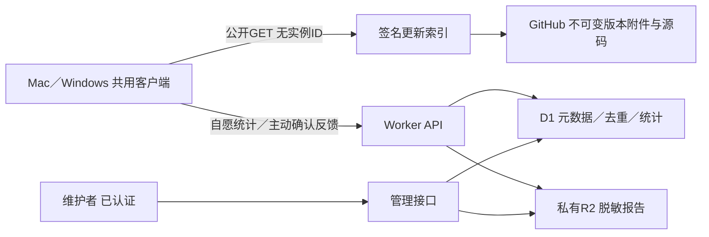

# Powerful6700 轻量服务端设计

2026-11-07，服务端专项设计第1版；用户已确认本方案的部署顺序与安全防护原则，接口及配置随实施定稿。尚未开发、创建云资源或部署。遵循[项目结构基线](跨平台与插件化方案.md)，只细化安装统计、反馈接收和更新分发，不改变本机设备锁、操作流程契约或发布审核要求。

## 1. 首版选型与责任

建议使用一个TypeScript Cloudflare Worker＋一个D1数据库＋一个私有R2日志桶；插件和安装包优先放GitHub Releases，更新索引由Worker静态资源发布。Cron用于补偿、聚合和过期清理。先不引入KV、队列、独立服务器、用户账号或远程相机任务系统。D1用于唯一约束、幂等和查询，R2只放结构化报告正文；不把日志正文塞进数据库。



将公开写接口、更新分发、维护者管理分为三个路由域。可在同一个Worker部署，但使用不同认证／缓存策略，更新路由不依赖D1／R2可用；后续可独立拆服务而不改客户端契约。真正公开的包文件与私有日志不得放同一个可公开桶。

云端不认证相机、不接收固件、不返回任意写入步骤或地址、不代替核心兼容性判定。服务端失败不阻断本地既有有效包的使用，不中断已经开始的事务。

## 2. 安装数：先明确统计对象

仪表盘显示三类不同指标，不能用下载量宣传为安装人数：

| 指标 | 定义 | 误差／局限 |
|---|---|---|
| 下载次数 | GitHub等渠道报告的附件下载次数 | 重下、CI、未安装、渠道重叠都会影响；只作单独参考 |
| 新增上报实例 | 同意统计后，随机安装实例ID首次被服务端接收 | 不是全部安装量或独立用户；重装清配置、复制配置、离线与拒绝统计会影响 |
| 日／周活跃实例 | 对应UTC日／近7个UTC日内有成功上报的去重实例 | 仅自愿上报样本；不能推断相机连接数或功能写入次数 |

- 首次设置提供独立的可选“帮助改进应用：发送最小化使用统计”，默认关闭；不影响使用、更新或反馈，也不与风险阅读捆绑。文案明确随机标识仍可关联同一实例的多次上报，不能宣称完全不可关联。
- 同意后在应用数据目录生成UUIDv4，仅用于本项目；应用升级及插件更新沿用。没有必要读取硬件UUID、MAC地址、用户名、相机序列号或创建跨应用指纹。
- 客户端同时生成独立的实例删除密钥（32随机字节），本机保留；服务端只存其摘要。停止统计立即停发并清空未发送队列，用户可另选删除现有实例记录。密钥不用于设备操作或插件下载。
- 正常启动后异步上报，最多每日一次，应用版本变化可额外上报以更新分布；短暂失败有界重试。CI、离线自测、模拟服务不产生统计事件；用户正常启动后只体验演示流程也可算软件实例，不要求连接相机。
- 首版只上报：API／同意文案版本、随机实例ID、应用版本、OS类型、CPU架构、发布通道。核心及插件详细版本留给问题反馈，不采集功能使用频次、相机型号、定位或行为轨迹。
- 首次上报时间使用服务端时间，不能把后来同意的日期当作真实安装日期。每日去重使用UTC边界，界面写明口径；客户端每天首个合适时机发一次即可，不靠客户端时钟保证服务端去重。
- HMAC服务端统计专用密钥将UUID映射成`install_key`后存库；这是减少原始标识暴露，不是匿名性保证。密钥轮换保留映射版本并设计迁移，不静默重计所有实例。
- 不同版本、平台占比以窗口内每实例最后一次上报为准，不将各版本活跃数相加当总人数。Mac与Windows是两个实例，默认不做跨设备“同一人”合并。
- 自报实例可伪造；CORS、客户端内置字符串、公有签名密钥均不能证明真实安装。本项目接受近似产品指标，不为追求绝对精确增加强制注册或设备指纹。

## 3. API契约草案

域名待定，以下为相对路由；HTTPS，JSON UTF-8，`/v1`表示接口大版本。普通客户端不需要GitHub／存储管理令牌。错误体只返回`code`、受控message、随机request_id及可选retry_after，不回显请求或原始异常。

| 方法／路由 | 调用方 | 输入／输出要点 | 幂等与缓存 |
|---|---|---|---|
| `GET /v1/health` | 运维／客户端 | 仅服务版本与存活，不泄露绑定与凭据 | 不作为每次设备操作前提 |
| `GET /v1/updates/{channel}/index.json` | 所有客户端 | stable／testing的已签名完整索引；客户端本地筛选OS／架构／core API | ETag／304，短缓存；无安装ID、Cookie及使用统计 |
| `POST /v1/telemetry/install` | 自愿参与客户端 | 随机实例ID、版本、平台及同意文案版本；删除密钥通过专用header | 实例唯一、每日去重，首次201／后续200；只在落库后确认 |
| `DELETE /v1/telemetry/install` | 实例持有人 | 实例ID＋删除密钥header | 204，重复同意删除亦可；密钥无效不披露该实例是否存在 |
| `POST /v1/feedback` | 用户确认反馈 | 随机feedback_id、描述、白名单诊断；独立反馈密钥header | 同ID同内容同密钥重试返回相同编号；内容或密钥冲突409 |
| `DELETE /v1/feedback/{id}` | 反馈持有人 | 独立反馈删除密钥header | 202进入可重试删除，完成后不再可读；按保留策略清理备份 |
| `GET /v1/admin/stats` | 维护者 | 时间窗口、平台、通道的聚合 | 认证，no-store；小样本合并呈现 |
| `GET /v1/admin/feedback` | 维护者 | 按版本、错误码、阶段、状态分页查询 | 认证，限制窗口与页数，no-store |
| `GET /v1/admin/feedback/{id}` | 维护者 | 完整脱敏报告／处理记录 | 认证授权，no-store，读取留审计 |
| `PATCH /v1/admin/feedback/{id}` | 维护者 | new／triaged／resolved，受控备注 | 更新元数据，不修改用户原报告 |

不提供公开的反馈列表或通过编号直接下载日志的接口。反馈编号只是便于用户引用的标识，不是日志读取凭据。首版无应用内查看工单回复、邮件发送或自动创建公开GitHub Issue。

安装请求示意：

```json
{
  "schema_version": 1,
  "installation_id": "<UUIDv4>",
  "app_version": "0.4.1",
  "platform": "windows",
  "arch": "x64",
  "channel": "stable",
  "consent_version": "usage-v1"
}
```

所有枚举、字符串长度、版本语法、JSON深度、事件数和未知字段均受schema检查；客户端传来的“同意”只是协议声明，不证明真的显示了界面，客户端行为仍需独立测试。删除密钥通过header传递，不放URL、反馈文字或普通日志；首次成功提交后不得在后续请求中更换密钥。

## 4. 数据结构与保留期限

以下是逻辑表，不是已执行的迁移；具体DDL随实现补齐约束、索引与迁移测试。

| 表／对象 | 主键与主要字段 | 用途／期限建议 |
|---|---|---|
| `installations` | `install_key` PK，key_version、delete_secret_hash、first_reported_at、last_reported_at、last_app_version、platform、arch、channel、consent_version | 最近180天仍活跃的假名化实例；不等同总安装人群 |
| `installation_days` | `(utc_day, install_key)` UNIQUE，last_app_version、platform、arch、channel、last_reported_at | 保留35天；支撑日活／7日活和最近版本分布 |
| `daily_metrics` | `(utc_day, metric, platform, channel)` UNIQUE，count、definition_version | 从已去重事实生成的聚合，保留24个月；没有实例ID |
| `feedback` | `feedback_id` PK，body_sha256、object_key、bytes、delete_secret_hash、upload_state、triage_status、schema_version、app/core/platform版本、受控error_code／stage_id、created_at、expires_at | 反馈元数据和查询；正文与可识别索引到期清理，处理状态留期需明示 |
| `admin_audit` | 随机ID、维护者标识、操作类型、feedback_id、时间 | 不记录正文、IP或token；建议90天 |
| R2 `feedback/YYYY/MM/<random-id>.json` | 服务端构造对象名，Content-Type固定application/json | 正文30天；Lifecycle作为兜底，Cron负责元数据一致性 |
| Worker静态更新文件 | 通道索引、签名、公钥轮换声明 | 不在D1动态生成，不随统计数据改变 |

新增实例和当天活跃事实使用唯一约束及D1批处理／事务语义原子处理，不能“查一下再无约束插入”。每日计数由去重事实聚合覆盖生成，不对每次请求盲加1。统计按定义版本记录；处理历史数据时不静默更改口径。

180天未上报的实例明细清理后，再次上报会被视为新上报实例。因此累计历史首报聚合不保证终身去重；清配置、重装或拷贝ID同样产生偏差。页面明确“自愿上报实例”，不能称“准确累计安装数”或“当前保有量”。服务端无法可靠检测卸载。

停止统计与删除分开：客户端先停发并清队列，再提交删除；服务端短期保留不含版本明细的删除墓碑（建议7天），拒绝在途迟到请求重建该实例。删除会去掉实例与其日明细，重算可识别范围内的活跃；已有无法反查到个人的聚合默认保留并在说明中披露。删除完成后客户端若再次主动启用统计则生成新ID。保留期都是产品建议，实施时根据地区、用户说明和成本确定；不在设计阶段承诺法律合规或精确删除时点。

## 5. 反馈上传与可靠性

客户端从本机已结束或中断的会话构建脱敏报告。包含operation_id、应用／核心版本、适配器版本、插件和流程摘要、feature_id、step_id、状态来源（人工／自动／计时）、耗时、错误分类及复现描述；不默认附installation_id，统计同意与反馈同意互相独立。

允许的诊断结构先在客户端白名单生成，再在服务端校验；禁止任意文件／ZIP、截图、二进制和压缩请求体。首版请求上限建议1MiB、2000条结构化事件、描述2000字符，读取流超过上限立即停止，不能仅信Content-Length。只保留固定错误码、模块／步骤ID和受控摘要，不接收任意stdout或traceback。描述可能包含用户主动填写的私人内容，预览中提示其检查，服务端不宣称能自动消除所有秘密。

用户流程：选择本次会话→填写问题→预览内容、大小、接收位置与保留期→确认上传→返回反馈编号；可导出相同脱敏内容。原固件前态、备份、ProductInfo、相机序列号、认证数据、FTP账户／地址、私人路径不得进入报告。

每次反馈预先生成随机feedback_id与独立32字节反馈密钥（本机保存），序列化最终JSON后计算body_sha256。反馈ID同时为幂等键；同一次重试不得更换内容或密钥，修改描述则生成新的反馈ID。服务端只保存密钥摘要；它只授权删除这份反馈，不授权读取别人的日志。编号公开不泄露删除能力。

R2与D1没有跨产品原子事务，采用显式状态与补偿：

1. 校验长度／schema／限流，按feedback_id写入`pending`，绑定正文摘要和密钥摘要；并发同ID依靠唯一约束处理。
2. 把已通过检查的精确JSON写入确定的私有对象名；重试只可写同摘要内容，不允许覆盖成另一份报告。
3. 核对对象长度／摘要后将D1状态置`ready`。仅此时向客户端返回201或重试200，含feedback_id和保留期；`pending`不得显示“上传成功”。
4. 对象失败或D1确认失败返回受控503；客户端保留同ID／同字节／同密钥，提示重试或导出。不因超时断言失败而新建另一份反馈。
5. Cron处理超时pending：内容完整且摘要一致则完成，否则清理孤立对象并标明失败。建议pending一小时内核对；删除使用`deleting`状态及幂等重试，先停止管理端读取，再删R2与相关元数据。
6. 删除中的ID保持无正文的有限期墓碑（例如7天），拒绝迟到重试重新创建。到期正文先停止可读，再执行清理；若Lifecycle已删正文，管理API明确返回已过期，不当作系统故障。

原始问题报告不可由维护者就地改写；分类及处理备注存独立字段。浏览器管理界面只按纯文本渲染描述，拒绝执行HTML、脚本或任意外链。首版用管理JSON接口／简易只读页面完成定位，不引入大型工单系统。

## 6. 插件与应用更新分发

索引是发布产物，不是数据库查询结果。安装统计开关不影响GET更新；GET更新不得生成或要求installation_id。保持平台／CPU筛选在客户端，避免一堆不同缓存版本；stable和testing各一份完整小索引。

签名索引列出：schema、发布序号、生成／到期时间、通道、应用平台附件、功能包及精确适配集、最低core API、依赖、修改／流程／验收定义摘要、下载地址、长度、SHA-256、源码及许可地址、撤回条目。索引及包都必须验签／校验，服务器JSON错误不能控制USB或跳过本机守卫。

- 发布流程：PR及来源审核→离线／原生仿真／对应机身验收→成组构建包和源码→签名→上传不可变版本附件→核对所有附件→最后更新通道索引。用户审核后才允许GitHub提交／发布或线上更新。
- 发布签名私钥不放Worker、公开仓库或客户端。离线签名／受保护发布步骤单独持有；Worker只能托管已签名内容。管理端收到日志不能触发构建、签名或发布。
- 使用明确签名封装，例如精确UTF-8 payload字节的Base64＋签名数组与key_id，客户端验签后严格解析（拒绝重复JSON键、未知schema及超限字段）。不得依赖不同语言各自JSON重序列化后恰好相同。
- 信任公钥由应用固定；轮换声明由已有可信密钥签署，带有效期与单调序号。信任根失陷不能靠同一失陷根自我证明修复，需预置恢复机制或应用升级。
- URL限定HTTPS及已审查的下载源／重定向目标；镜像只服务同一签名、长度和摘要的文件。不允许客户端提交一个任意URL让Worker代理下载。
- 索引短缓存，例如5分钟；版本化包长缓存不可变。撤回时发更高序号索引并清缓存；离线客户端看不到新撤回信息，不能承诺立即全网生效。过期索引不用于激活新包，旧包策略按架构基线执行。
- 网络恢复／索引变化不热替换操作中固定的包、流程、文案和验收标准。服务只提供候选版本，本机核心仍执行身份、准备、排队、锁、守卫和回读。
- 撤回／切回本机包不等于相机回滚；没有已验证迁移路径时停止新写入，保留诊断及恢复资料，不发自动重刷命令。
- 首版不把每次下载／更新检查都写D1。GitHub下载量与自愿上报实例分开显示；插件使用／安装统计不在首版采集范围。

静态索引可以独立镜像在GitHub，客户端按固定公钥与同一摘要验证，不因后端数据库宕机失去更新检查。若采用Tauri updater，应用更新附件签名与本项目能力包／索引签名协议分别适配，不假设格式天然相同。

## 7. 权限、限流与成本边界

| 边界 | 首版规则 |
|---|---|
| 客户端 | 无共享管理secret；实例／反馈随机删除密钥只授权自身删除，不证明真实用户或真实安装 |
| 管理接口 | 独立管理域名或Access保护路由，维护者身份认证；若代码校验Access JWT则核对签名／issuer／audience／有效期，不只相信一个header |
| 角色 | 查看／分类／删除分权；发布不在日志管理API中 |
| CORS | 仅已知应用源，允许无浏览器Origin的原生客户端；CORS不是身份认证或防滥用手段 |
| 请求体 | 统计建议4KiB，反馈1MiB；限制流、JSON深度、字段与事件数，拒绝压缩体和未知附件 |
| 限流 | 按端点、短期IP-HMAC及实例／反馈ID多层限流；共享出口需允许合理余量，不把IP当安装ID |
| 大盘保护 | 每日反馈字节／件数预算和新实例注册预算；达到上限暂停接收并返回429／503，客户端保留导出，更新GET继续工作 |
| 日志 | 不记录请求正文、删除密钥、完整查询或原始IP；统计与反馈路由禁用可泄露正文的调试采样；CDN自身访问日志策略另披露 |

Workers本地限流绑定可作为防突发手段，不是跨区域严格全局计数器；需要硬的每日预算时，用D1条件更新与预留／释放额度完成。共享配额行高竞争后再考虑Durable Object，不先引入。IP-HMAC按日换盐并短期清理；仍可能关联短期请求，不能称绝对匿名。

在已有每日去重记录上增加事件不重复占新增实例预算。对反馈pending预留请求长度，失败后按补偿释放；并发攻击不能先无限写R2再检查配额。未认证请求也会产生成本，边缘限流和总量熔断须在昂贵持久化之前。

示例容量仅用于估算：一万个自愿活跃实例每天上报一次约一万请求／天；100份反馈／天、平均200KiB、保留30天，正文约586MiB（不含元数据、失败对象、请求费用及备份）。不承诺免费或固定月费，部署前核对Workers／D1／R2当前价格、配额、地区可达性与用户网络表现。客户端统计不在USB关键路径，首版无需秒级实时仪表盘。

### 7.1 恶意上传与剩余风险（用户已确认的防护原则）

公开接收接口按“不可信请求必然存在”设计。不能保证请求来自真实应用或真实用户；开源客户端内藏共享API Key、校验User-Agent或配置CORS，都不能证明来源真实性。目标是限定影响、保护隐私、控制资源消耗，并能暂停接收，不承诺零攻击或零成本。

| 风险 | 实现必须具备的防护 | 仍存在的边界 |
|---|---|---|
| 垃圾上传／存储耗尽 | 边缘防突发、实例／反馈维度限流、每份大小限制、每日件数与字节预算、持久化前预留额度 | 分布式来源可能绕过单IP限流，合法用户也可能遇到预算耗尽 |
| 上传恶意文件／解压炸弹 | 仅固定schema的JSON；拒绝压缩体、ZIP、可执行文件、图片及任意附件；不解压、不执行正文 | 合法结构内仍可能有垃圾／敏感描述，不能靠JSON格式证明可信 |
| 文本攻击后台／查询注入 | 描述纯文本渲染；数据库参数化查询；不拼接SQL、shell或模板；不抓取正文中的链接 | 后台仍需依赖更新、权限测试和维护者账号保护 |
| 猜反馈编号／窃取日志 | R2不开公共访问；后台认证与逐路由授权；删除密钥只授权自身删除；不暴露公开日志下载 | 管理员凭据或后端权限被攻破仍可能泄露已接收报告 |
| 伪造安装统计 | 唯一约束、每日去重、限流、异常标记；指标注明自愿上报实例 | 不做硬件指纹／强制登录，不能可靠阻止批量伪造实例或称准确人数 |
| 伪造／替换插件 | 客户端固定信任根、验签、摘要与兼容检查；发行私钥不在Worker；日志管理无发布权 | 服务遭入侵仍可能拒绝服务或投递旧的未过期签名内容，不能承诺可用性与即时撤回 |
| 用户误填隐私 | 上传前预览／删除；结构化白名单；私有保存、有限保留和删除流程 | 无法自动识别所有秘密，不能把收到的描述默认当作已彻底脱敏 |

首版按单份反馈最多1MiB、正文30天保留、每日总接收件数／字节封顶实施；具体每日额度在staging压测与预算审核后配置，不在代码里无限放行。分别提供`feedback_ingest_enabled`和`telemetry_ingest_enabled`开关，只控制新接收，不阻止用户删除已有资料、维护者清理、静态更新下载或本机操作。

达到额度、异常增长或存储／数据库故障时，接口返回受控429／503和可用的重试提示；客户端不循环重试，保留本地脱敏报告并提供导出。仪表盘区分“服务暂停接收”与“用户上传失败”，避免错误引导用户重刷相机。对限流命中数、接收字节、pending积压、错误率及清理失败设置告警，告警也不附正文或密钥。

必须明确：限流与持久化预算降低风险，但拒绝请求本身仍可能产生成本；服务端接收熔断不是Cloudflare账单的绝对硬上限。部署前核对当前套餐可用的边缘防护、计费／配额和告警能力，不能以“用了Cloudflare”代替实测，也不能承诺恶意流量完全免费。

## 8. 目录、环境与维护

未来代码建议放在唯一应用工程的`services/cloud/`，与客户端包协议共用版本化schema；本轮不创建空目录／无用服务脚手架。公开仓库同步同一来源，不再各开发一套服务。

```text
services/cloud/
  README.md                 # 本地运行、职责、部署与回滚
  src/index.ts              # 固定路由分发，不堆业务
  src/updates/              # 已签名静态产物与缓存
  src/telemetry/            # 同意字段、实例去重、聚合
  src/feedback/             # schema、幂等、正文存储、清理
  src/admin/                # 维护者授权、查询、分类
  src/storage/              # 数据库／对象存储适配
  src/contracts/            # 客户端共用JSON schema和受控错误码
  src/jobs/                 # 聚合、pending补偿、过期删除
  migrations/               # 递增DDL；不手工修改生产表
  tests/                    # 契约、并发、失败、隐私、权限
  wrangler.jsonc            # 不含secret；环境隔离
```

开发使用本地模拟；staging与production分别拥有绑定、密钥与存储，生产数据不复制到开发。发布资源ID、账号与域名在实际部署时按Topo／Cloudflare既有技能读取，不写进设计或公开包。开发／部署凭据与发布签名密钥分离，所有管理操作留审计；统计及日志服务不与家庭相机调试台相连。

服务升级：审查与本地测试→staging集成测试→用户审核→数据兼容的迁移／部署。新增字段先兼容旧客户端；删除字段需新API版本及退役窗口。回退Worker版本不等于回退数据库，因此优先增量迁移，保留旧代码可读路径。D1与R2备份、到期清理、恢复窗口共同登记，不把“主桶30天清理”宣称所有副本立即删除。

对外更新索引按已签名序号推进，不能靠回退Worker部署来静默回退包索引；需要撤回时发布新的有审计索引。运维故障保持更新静态路由和本地已验证包可用，反馈接收可单独熔断。

### 8.1 部署顺序与上线门槛

1. **本地实现和合成验证**：先完成API、schema、数据库迁移、幂等、补偿与限额；测试不使用私人日志或相机。创建云资源前按现有审核要求明确账号、域名、区域和预算，凭据经既有安全入口读取，不发送到聊天或写入仓库。
2. **隔离staging环境**：创建独立Worker／D1／私有R2，配置仅测试环境的密钥、管理员认证、日志脱敏及清理任务。先装好防护再暴露测试上传入口，不接真实生产数据。
3. **封闭管理访问路径**：公开更新只读，公开统计／反馈只能访问规定路由；维护者读、分类、删除均独立认证授权。检查自定义域名、workers.dev、预览／版本URL及别名：未保护的入口关闭，或必须执行相同后端认证，不能只在一个域名上套Access而让备用地址绕过。R2公共域名和公共访问保持关闭；客户端仅通过受限Worker接口提交，不持有存储写凭据。
4. **完成滥用与故障验证**：超大、压缩、过深JSON、未知字段、持续上传、跨来源并发、共享出口、批量伪造ID、同ID不同内容、猜编号／删除密钥、HTML／SQL文本、数据库／对象存储失败、清理及迟到重试均须覆盖。只检查“正常上传成功”不算上线验收。
5. **提交具体上线材料审核**：给出接口版本、绑定与权限范围、部署配置、每日限额、保留与隐私说明、staging结果、回退及暂停办法。代码／GitHub／生产部署分别遵守已有审核范围，不沿用本次文档确认当作上线授权。
6. **小范围正式接入**：审核后部署生产环境，先接少量测试用户，观察拒绝率、延迟、额度、费用及日志可定位性。扩大开放前验证两端断网、上传暂停、索引损坏与版本固定；不能因云端接入影响原有USB操作。

上线检查须证实：匿名请求读不到私有日志；所有管理入口认证一致；发布私钥不在服务运行环境；流量与存储预算有效；一键暂停上传后插件下载仍可用；用户仍可导出日志、使用已验证本地包；清理与故障告警真实生效。任一关键项未通过，保持测试环境或暂停接收，不先公开再补防护。

应急顺序：暂停受影响的新接收→限制或关闭异常路由→核查权限和凭据、保护审计记录→按证据决定凭据轮换／索引撤回→验证修复后恢复。不得把上传正文直接复制到公开Issue或CI日志来排障；账号／后台失陷时另行评估数据暴露范围。暂停接收不自动关闭更新，也不触发相机刷写或回滚。

## 9. 实施批次与验收

1. **契约与本地验证**：固定统计口径、同意／撤回流程、白名单诊断、API schema、签名索引封装及数据保留规则；用合成数据验证，不读取个人记录。
2. **最小服务**：Worker＋D1＋私有R2，完成幂等上传、返回编号、删除／到期补偿、维护者读取；先staging，再按审核部署。
3. **共用客户端接入**：Mac／Win共用模块，分别测试权限、路径及断网；统计可关，反馈可预览导出，更新包版本固定，不修改相机事务。
4. **更新通道与运维**：接入签名索引、GitHub版本附件及回滚说明、管理统计、限流／预算监测。功能插件加载仍按本机架构基线实施，不由后端开发替代。

必须覆盖：重复／并发首次注册只计一次；一天内升级版本不增加DAU；拒绝／撤回统计不发送且不影响更新；反馈超时重试不重复；同ID换内容或密钥拒绝；R2成功D1失败可补偿；删除／过期与迟到重试不复活日志；管理未授权读拒绝；猜到反馈ID不能读日志；正文／凭据不进入服务日志；大小与全局预算有效；索引损坏、旧序列、未知签名和不兼容核心被拒绝；统计／D1／R2宕机不阻断静态更新及本地USB；两端一次操作中途收到新索引仍用原流程和验收文案。

部署前待定：域名与Cloudflare账号／区域、预算上限、30／35／90／180天等保留期、统计说明文案和维护者访问方式。以上是配置与上线决策，不要求现在新建任何资源或提供凭据。

## 10. 参考与本轮边界

本轮只完成服务端结构设计与链接／目录检查，没有实现接口、统计安装、上传个人日志、部署Cloudflare或提交GitHub。根架构及本专项部署／防护原则已由用户确认，具体接口与配置随实现定稿和审核，不宣称线上可用。

- [Workers存储选型](https://developers.cloudflare.com/workers/platform/storage-options/)：关系数据与对象存储职责。
- [D1限制](https://developers.cloudflare.com/d1/platform/limits/)：实施前核对数据库与查询约束。
- [R2生命周期](https://developers.cloudflare.com/r2/buckets/object-lifecycles/)：日志对象到期机制，不替代应用层元数据一致性。
- [Workers限流绑定](https://developers.cloudflare.com/workers/runtime-apis/bindings/rate-limit/)：防突发能力与分布式局限。

- [R2公开访问边界](https://developers.cloudflare.com/r2/buckets/public-buckets/)：日志桶不开放公共访问。
- [Cloudflare Access应用保护](https://developers.cloudflare.com/cloudflare-one/access-controls/applications/http-apps/self-hosted-public-app/)：管理入口保护，仍需检查别名及备用地址。
